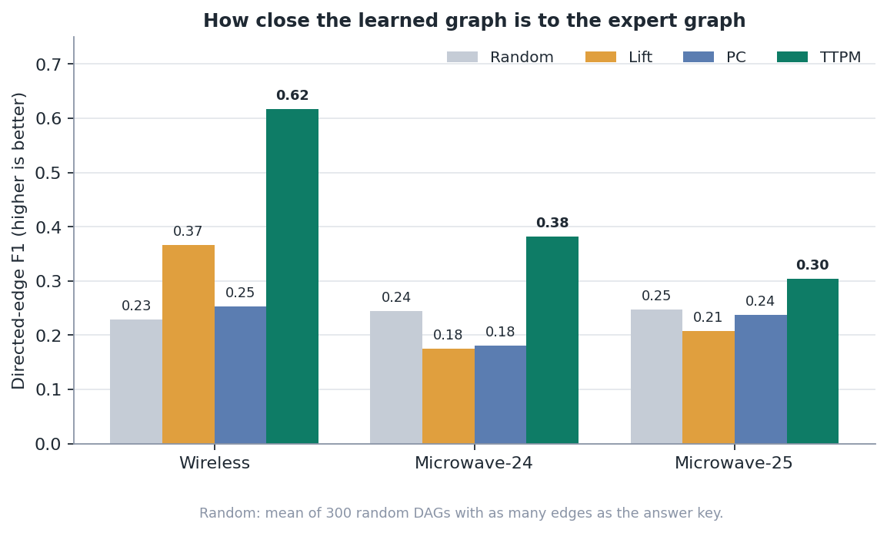
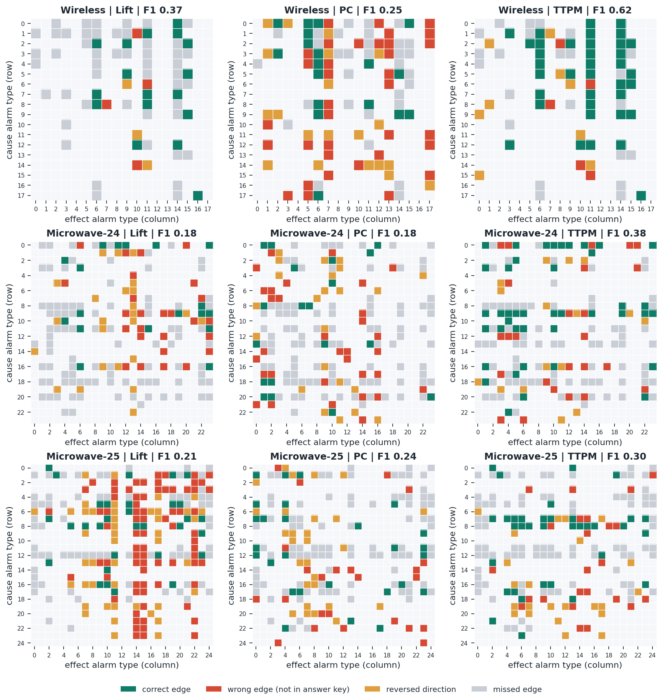
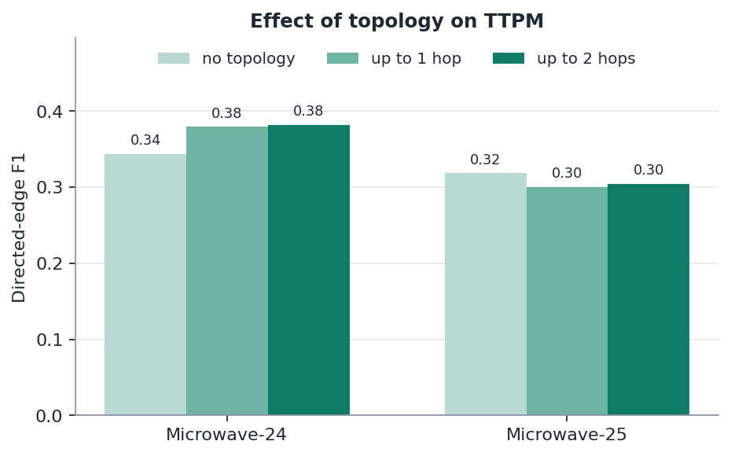
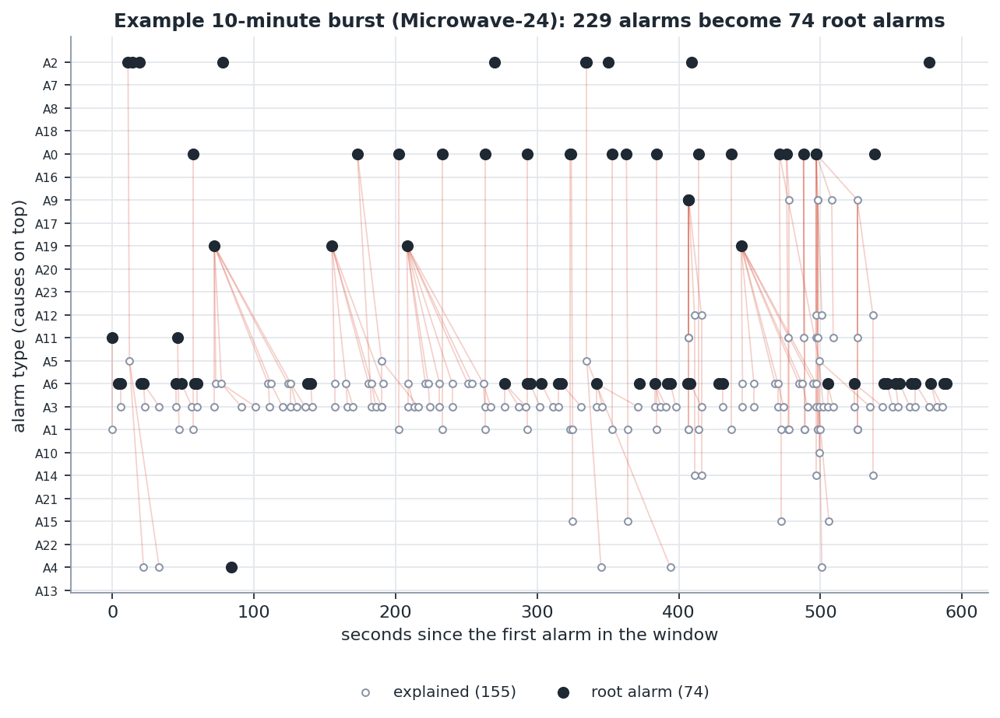

# Finding the Root-Cause Alarm in an Alarm Flood

  

Causal discovery on real telecom alarm logs from Huawei Noah's Ark Lab (released through [gCastle](https://github.com/huawei-noah/trustworthyAI/tree/master/gcastle)). The project compares a simple time-association baseline, the PC algorithm and a topological Hawkes-process model (TTPM) against expert-drawn cause-and-effect graphs, then uses the learned graphs to triage alarm floods. It ships with an executed notebook, an interactive Streamlit dashboard, tests, and all result files, so you can try it without re-running anything.



## Contents

- [Why this problem](#why-this-problem)
- [Results at a glance](#results-at-a-glance)
- [Quick start](#quick-start)
- [Using the dashboard](#using-the-dashboard)
- [Reproduce the experiments, notebook and tests](#reproduce-the-experiments-notebook-and-tests)
- [Try it from Python](#try-it-from-python)
- [How it works](#how-it-works)
- [Alarm triage](#alarm-triage)
- [Project structure](#project-structure)
- [Deploy the dashboard](#deploy-the-dashboard)
- [Troubleshooting](#troubleshooting)
- [Limitations](#limitations)
- [Ideas for future work](#ideas-for-future-work)
- [References](#references)
- [License and author](#license-and-author)

## Why this problem

A single fault in a telecom network, such as a power outage or a failed microwave link, can trigger dozens of alarms across many devices at once. Operators in a network operations center (NOC) have to work out which alarm is the cause and which ones are only consequences. If the cause-and-effect relations between alarm *types* are known, one root alarm can replace dozens of tickets. Operators often encode these relations by hand as correlation rules, which is costly to maintain. This project asks whether such relations can be **learned from the alarm log itself**, and how close the result gets to a graph drawn by experts.

## Results at a glance

Three real datasets, each with an expert answer key (a graph of which alarm type causes which):

| Dataset | Alarms | Alarm types | Devices | Span | Topology | Edges in answer key |
|---|---:|---:|---:|---:|---|---:|
| Wireless | 34,838 | 18 | 55 | 240 days | none | 69 |
| Microwave-24 | 64,598 | 24 | 439 | 6 days | 395 links | 137 |
| Microwave-25 | 48,572 | 25 | 474 | 6 days | 440 links | 148 |

All methods use library defaults or common practice and are **not tuned with the answer key**. "Chance F1" is the mean F1 of random DAGs with as many edges as the method returned, which matters because the answer-key graphs are dense (22 to 25 percent of all pairs).

| Dataset | Method | Edges | Precision | Recall | F1 | Chance F1 | SHD |
|---|---|---:|---:|---:|---:|---:|---:|
| Wireless | Lift baseline | 24 | 0.71 | 0.25 | 0.37 | 0.12 | 56 |
| | PC | 73 | 0.25 | 0.26 | 0.25 | 0.23 | 86 |
| | **TTPM** | 51 | 0.73 | 0.54 | **0.62** | 0.20 | **37** |
| Microwave-24 | Lift baseline | 68 | 0.26 | 0.13 | 0.18 | 0.16 | 145 |
| | PC | 74 | 0.26 | 0.14 | 0.18 | 0.17 | 150 |
| | **TTPM** | 83 | 0.51 | 0.31 | **0.38** | 0.19 | **120** |
| Microwave-25 | Lift baseline | 151 | 0.21 | 0.21 | 0.21 | 0.25 | 193 |
| | PC | 79 | 0.34 | 0.18 | 0.24 | 0.17 | 145 |
| | **TTPM** | 82 | 0.43 | 0.24 | **0.30** | 0.18 | **137** |

F1 is computed strictly on directed edges using the convention of gCastle's `MetricsDAG`. Precision: out of every 10 relations reported, how many are in the expert graph. Recall: out of all relations in the expert graph, how many were found. SHD (structural Hamming distance): the number of corrections (add, remove, reverse) still needed; lower is better.



*Each cell is one pair (cause in the row, effect in the column). Green: correct. Red: edge not in the expert graph. Yellow: reversed direction. Gray: expert edge that was missed.*

### Findings

1. **TTPM is closest to the expert graph on all three datasets**, at 3.1 / 2.0 / 1.7 times the chance level. PC, which only sees a table of which alarms occurred, reaches 1.1 / 1.0 / 1.4 times, and the lift baseline 3.0 / 1.1 / 0.8 times.
2. **On the Microwave datasets every method is still far from the expert graph.** TTPM recall is only 0.31 and 0.24. PC and lift are at chance level on Microwave-24, and lift is below chance on Microwave-25.
3. **Topology helps inconsistently.** TTPM's F1 on Microwave-24 rises from 0.34 (no topology) to 0.38 (up to 2 hops); on Microwave-25 it falls from 0.32 to 0.30. Two datasets are too few to conclude.

   

4. **TTPM is stable with respect to its decay parameter delta.** Over a 100-fold range (0.01 to 1), F1 stays within 0.53 to 0.68 / 0.30 to 0.39 / 0.24 to 0.30. Even its worst setting matches or beats the best PC and lift configurations, which were picked using the answer key (0.53 vs 0.40; 0.30 vs 0.24; 0.24 vs 0.24, a tie on the third dataset).

### Context: Huawei's published scores

The `datasets` README in the gCastle repository lists F1 scores of some algorithms on the same datasets. These numbers are context only, not an apples-to-apples comparison, because the exact protocol and data preparation behind them are not fully known.

| Source | Wireless | Microwave-24 | Microwave-25 |
|---|---:|---:|---:|
| PC (Huawei's table) | 0.43 | 0.23 | 0.19 |
| THP (Huawei's table, [arXiv:2105.10884](https://arxiv.org/abs/2105.10884)) | 0.58 | 0.37 | 0.34 |
| PC (this project) | 0.25 | 0.18 | 0.24 |
| TTPM (this project) | 0.62 | 0.38 | 0.30 |

PC is lower here on Wireless, probably because of how the log is turned into a table. TTPM lands in the same range as THP.

## Quick start

The fastest way to try the project is the dashboard. It reads the raw data and the result files that are already in the repository, so it needs neither gCastle nor PyTorch.

**You need:** Python 3.12 (the version this project was built and tested with), a terminal, and a web browser.

**1. Get the code.** Either download the ZIP from GitHub and extract it, or clone:

```bash
git clone https://github.com/Ahayrai18/telco-alarm-rca.git
cd telco-alarm-rca
```

**2. Open a terminal inside the project folder** (the folder that contains `README.md`). On Windows you can open the folder in File Explorer, type `cmd` in the address bar and press Enter. In VS Code use *File > Open Folder*, then *Terminal > New Terminal*.

**3. Create a virtual environment** (see the [venv docs](https://docs.python.org/3/library/venv.html)).

Windows:

```bat
python -m venv .venv
.venv\Scripts\activate
```

macOS / Linux:

```bash
python3 -m venv .venv
source .venv/bin/activate
```

The prompt should now start with `(.venv)`.

**4. Install the dashboard requirements** (one to three minutes):

```bash
pip install -r requirements.txt
```

**5. Start the dashboard:**

```bash
streamlit run app/streamlit_app.py
```

**6. Open the address printed in the terminal** (normally `http://localhost:8501`) in your browser. This project does not open the browser automatically. Press `Ctrl+C` in the terminal to stop the server.

## Using the dashboard

The **Dataset** box at the top applies to every tab. The three choices are Wireless, Microwave-24 and Microwave-25.

| Tab | What it is for | What to do |
|---|---|---|
| **Results overview** | The headline comparison of methods. | Hover over a bar to see exact numbers. Read the *Details* table for the selected dataset: edges found, correct/wrong/reversed edges, precision, recall, F1, chance F1, SHD and runtime. |
| **Alarm data** | Get to know the data. | See alarm volume over time, alarms per type, and data characteristics (zero-duration alarms, alarms recorded in the same second, topology size). |
| **Causal graph** | Compare a learned graph with the answer key. | Pick a graph in *Graph to compare with the answer key* (TTPM, PC, Lift baseline; on Microwave also TTPM with no topology or up to 1 hop). Switch *View* between **Graph** and **Edge matrix** (the matrix is easier to read for the Microwave datasets). Tick *Show missed edges* to see expert edges the method did not find. Green = correct, red = wrong, yellow = reversed, gray = missed. Open *Edge list* for a table. |
| **Triage simulation** | Use a graph to filter an alarm flood. | Choose the graph, the time gap allowed between a parent and a child alarm, the topology hops (Microwave only), the width of the burst window, and one of the eight busiest bursts. Filled black dots are root alarms; small hollow dots are explained alarms, joined by a red line to their parent. The table lists the root alarms that explain the most alarms. |
| **Methods and limitations** | How the methods work and how far to trust them. | Read the three methods, the sensitivity chart for TTPM's delta, and the limitations. |

**Checkpoints.** With the default settings (time gap 60 s, burst width 10 min, first burst in the list), the *Triage simulation* tab shows:

| Dataset (busiest burst) | Graph | Root alarms | Explained |
|---|---|---:|---:|
| Wireless (33 alarms) | Expert | 16 | 52% |
| | TTPM | 15 | 55% |
| Microwave-24 (485 alarms) | Expert | 235 | 52% |
| | TTPM | 428 | 12% |
| Microwave-25 (720 alarms) | Expert | 382 | 47% |
| | TTPM | 381 | 47% |

Read these numbers with care: **explained does not mean correct.** On a single burst a random graph can explain many alarms, which is why the tab also shows a random graph of the same size (mean of 5 draws). The Microwave-24 gap (TTPM 12% vs expert 52%) is explained under [Limitations](#limitations). Things to try: raise the time gap from 60 to 300 seconds and watch the explained share grow; switch between the expert graph and TTPM on the same burst; lower the topology hops from 2 to 0.

## Reproduce the experiments, notebook and tests

Install the extra requirements (gCastle, Jupyter, pytest):

```bash
pip install -r requirements-experiments.txt
```

**Notebook.** The notebook `notebooks/01_alarm_root_cause_analysis.ipynb` is already executed, so you can read it (also on GitHub) without running anything. To run it yourself:

```bash
jupyter lab
```

Open the notebook from the file browser, then *Run > Run All Cells* (two to four minutes). A cell titled *Reproducibility check* asserts that the live numbers equal `results/metrics.csv`. You can also open the notebook in VS Code with the Jupyter extension and select the `.venv` kernel.

**Experiments.** The result files are included, so by default the script skips datasets that already have results:

```bash
python scripts/run_experiments.py                   # prints "already done, skipped"
python scripts/run_experiments.py --force           # recompute everything (about 10 to 15 minutes on 1 CPU)
python scripts/run_experiments.py --datasets 18V_55N_Wireless --force   # one dataset, about 1 minute
python scripts/run_experiments.py --aggregate       # only merge existing per-dataset results
python scripts/make_figures.py                      # regenerate results/figures/*.png
```

The methods are deterministic, so the numbers reproduce exactly (only runtimes change).

**Tests.**

```bash
pytest
```

You should see `22 passed`. The tests cover the metrics (compared with gCastle's `MetricsDAG`), `FastTTPM` (compared with the original TTPM), the cached Fisher-z test, the triage logic, the dataset files, and a smoke test that runs the dashboard for every dataset and graph.

## Try it from Python

Save this as `try_it.py` in the project folder and run `python try_it.py` (needs `requirements-experiments.txt`):

```python
import sys; sys.path.insert(0, "src")
from alarmrca.data import load_dataset
from alarmrca.ttpm_fast import fit_ttpm
from alarmrca.metrics import graph_metrics
from alarmrca.rca import explain_alarms

ds = load_dataset("18V_55N_Wireless")
res = fit_ttpm(ds.alarms, ds.topology, ds.n_types, delta=0.1, max_hop=0)   # about 5 seconds
print(graph_metrics(res.graph, ds.true_dag))       # F1 0.6167, SHD 37
ex = explain_alarms(ds.alarms, res.graph, ds.topology, ds.n_devices, window=60, hops=0)
print(1 - ex["is_root"].mean())                    # about 0.24 of alarms are explained
```

Exercise: change `delta` to `0.01` (F1 about 0.66) and `1.0` (about 0.53) to see how stable TTPM is.

## How it works

**Data and answer key.** Each dataset has an alarm table (`alarm_id`, `device_id`, start and end time in seconds), an expert graph over alarm types (`DAG.npy`) and, for the Microwave datasets, a device topology (`Topology.npy`). See [`data/README.md`](data/README.md).

**Lift baseline** (`baseline.py`). For every pair of alarm types (a, b), compute the share of b alarms preceded by an a alarm within 60 seconds on the same device or a neighbor, and divide by the chance level under a per-device Poisson approximation. A pair becomes an edge when lift is at least 3, confidence at least 0.05 and support at least 20 events. Because alarms are rare, lift easily reaches the thousands; confidence and support are the thresholds that actually filter.

**PC** (`pc_method.py`). A constraint-based algorithm ([Spirtes and Glymour, 1991](https://doi.org/10.1177/089443939100900106)) run through gCastle. The log becomes a 0/1 table with one row per device per 10-minute window and one column per alarm type, so PC sees neither event order inside a window nor the topology.

**TTPM** (`ttpm_fast.py`). A topological [Hawkes-process](https://en.wikipedia.org/wiki/Hawkes_process) model from gCastle. Every alarm raises the rate of other alarms on the same device and on neighbors up to *H* hops away, with an influence that decays exponentially at rate delta (default 0.1 per second). The graph is searched by hill climbing on the [BIC](https://en.wikipedia.org/wiki/Bayesian_information_criterion) score, with parameters fitted by EM. The method builds on the topological Hawkes process of [Cai et al.](https://arxiv.org/abs/2105.10884).

**Optimization: FastTTPM.** gCastle's hill climbing re-scores every alarm type for each candidate edge, but adding the edge j → i only changes the score of type i, because the Hawkes likelihood factorizes per child. `FastTTPM` caches the score of each (child, parent set), so a candidate needs at most one new EM run. Formulas and search order are unchanged, and `tests/test_pc_and_ttpm.py` checks that the resulting graph equals the original TTPM's. On test subsets (1,500 to 3,000 alarms) it is 20 to 60 times faster. On the full Microwave-24 data one original `_em` call takes about 0.7 s and one hill-climbing iteration evaluates 552 candidates, so the 84 iterations would take roughly 9 hours; this is an extrapolation and was not run. `FastTTPM` finishes the same dataset in under a minute. PC is sped up the same way with a Fisher-z test that computes the correlation matrix once (`cached_fisherz`), giving the identical graph.

**gCastle without PyTorch.** gCastle 1.0.x imports torch when `castle.algorithms` loads, although PC and TTPM do not use it. `src/alarmrca/compat.py` falls back to loading just those two modules when torch is not installed.

## Alarm triage

An alarm is **explained** when the graph gives its type a parent and an alarm of that parent type occurred at most 60 seconds earlier on the same device or a neighbor (up to 2 topology hops; on Wireless the same device only). Unexplained alarms are **root alarms**. Each alarm points to its nearest parent in time, so every root alarm owns a tree of descendants and roots can be ranked by the number of alarms they explain.



*An example 10-minute burst on Microwave-24 under the TTPM graph: 229 alarms become 74 root alarms. The example was chosen as the best-explained burst among the 20 busiest, so it is not representative. The busiest burst (485 alarms) leaves 428 root alarms under TTPM but only 235 under the expert graph.*

Over the whole log, the TTPM graph explains 24 / 49 / 51 percent of alarms, the expert graph 21 / 45 / 44 percent, and a random DAG of TTPM's size only 4 / 20 / 18 percent. **These percentages are not accuracy**: the datasets contain no cause labels for individual events, and the TTPM graph is learned from the same log. The triage here demonstrates how a graph can be used; it does not claim correctness.

## Project structure

```
app/streamlit_app.py            dashboard
src/alarmrca/
  data.py                       dataset loader
  metrics.py                    precision / recall / F1 / SHD, random-DAG reference
  events.py                     fast "preceding alarm" lookup (vectorized with merge_asof)
  baseline.py                   lift baseline
  pc_method.py                  PC and the cached Fisher-z test
  ttpm_fast.py                  FastTTPM
  rca.py                        triage: root alarms and their descendants
  viz.py                        static figures
  compat.py                     import gCastle without torch
scripts/run_experiments.py      all experiments, output to results/
scripts/make_figures.py         README figures
notebooks/                      full analysis (already executed)
tests/                          metrics vs gCastle, FastTTPM vs original TTPM, triage, dashboard
results/                        metrics.csv, sensitivity.csv, triage.csv, learned graphs (npz), figures
data/raw/                       the three datasets (Apache-2.0, see NOTICE)
```

## Deploy the dashboard

1. Push the repository to GitHub. The `results/` and `data/raw/` folders must be included because the dashboard reads them.
2. Go to [share.streamlit.io](https://share.streamlit.io) (see the [Community Cloud docs](https://docs.streamlit.io/deploy/streamlit-community-cloud)), choose *Create app*, and fill in the repository, branch and the main file path `app/streamlit_app.py`.
3. Streamlit installs the packages from `requirements.txt` automatically.

## Troubleshooting

| Problem | Fix |
|---|---|
| `python` is not recognized (Windows) | Install Python from [python.org](https://www.python.org/downloads/) and tick *Add python.exe to PATH*, then open a new terminal. You can also try `py` instead of `python`. |
| PowerShell refuses to activate the venv | Run `Set-ExecutionPolicy -Scope Process -ExecutionPolicy Bypass` and activate again, or use Command Prompt (`cmd`). |
| `streamlit` is not recognized | The virtual environment is not active (no `(.venv)` in the prompt). Activate it, or run `python -m streamlit run app/streamlit_app.py`. |
| Port 8501 is already in use | Add `--server.port 8502` to the command. |
| The dashboard says the `results/` folder has no results | Make sure the terminal is in the project folder and that `results/` was extracted. |
| `ModuleNotFoundError: castle` | Install `requirements-experiments.txt`. It is needed for the notebook, the experiment script and the gCastle tests, not for the dashboard. |

## Limitations

- **The answer key is an expert annotation at the alarm-type level.** It may be incomplete, so precision can look lower than it really is. The datasets have no per-event cause labels, so triage accuracy cannot be measured.
- **TTPM (the gCastle implementation) does not see relations recorded in the same second**, because only alarms with an earlier timestamp are counted as influences (`nei_start_t < start_t` in `ttpm.py`). On the Microwave datasets 24 to 29 percent of alarms share a second with the previous alarm. A concrete case: in Microwave-24, 98% of A7 alarms are recorded on the same device and in the same second as an A8 alarm, the expert graph has A8 causing A7, and TTPM does not find that edge. This probably contributes to the low recall there.
- **Only three datasets, one data realization each.** Small differences between methods, such as the effect of topology, should not be read as definite. The methods are deterministic, so there are no repeated runs with different seeds.
- **The main configuration is not tuned**, while the best PC and lift configurations in the sweeps (`results/sensitivity.csv`) were chosen with the answer key. The comparison deliberately favors TTPM's competitors. How the log is turned into a table for PC also affects its result; the sweeps cover window type, window width and significance level but not every possible choice.
- **Huawei's reference scores** use a protocol that is not fully known; treat them as context.
- **The data come from networks of unknown origin** supplied by Huawei; results may not transfer to other networks.

## Ideas for future work

- Try other gCastle algorithms that accept event data, or the THP variant from its paper.
- Rewrite the Hawkes likelihood in [MindSpore](https://github.com/mindspore-ai/mindspore) so edges are learned with gradients and an L1 penalty instead of hill climbing.
- Handle simultaneous alarms explicitly, for example by modeling same-second co-occurrence.
- Ask domain experts to validate a few alarm bursts to judge triage quality at the event level.

## References

**Toolkit and data**

- gCastle repository: <https://github.com/huawei-noah/trustworthyAI/tree/master/gcastle>
- gCastle documentation: <https://gcastle.readthedocs.io>
- Zhang, K., Zhu, S., Kalander, M., Ng, I., Ye, J., Chen, Z., Pan, L. *gCastle: A Python Toolbox for Causal Discovery.* 2021. <https://arxiv.org/abs/2111.15155>
- Alarm datasets: <https://github.com/gcastle-hub/dataset/tree/master/alarm>
- Dataset descriptions and Huawei's reference scores: <https://github.com/huawei-noah/trustworthyAI/tree/master/datasets>

**Methods**

- Cai, R., Wu, S., Qiao, J., Hao, Z., Zhang, K., Zhang, X. *THP: Topological Hawkes Processes for Learning Causal Structure on Event Sequences.* IEEE Transactions on Neural Networks and Learning Systems. <https://arxiv.org/abs/2105.10884>
- Hawkes, A. G. *Spectra of some self-exciting and mutually exciting point processes.* Biometrika 58(1), 83-90, 1971. <https://doi.org/10.1093/biomet/58.1.83>
- Spirtes, P., Glymour, C. *An algorithm for fast recovery of sparse causal graphs.* Social Science Computer Review 9(1), 62-72, 1991. <https://doi.org/10.1177/089443939100900106>
- Background: [Hawkes process](https://en.wikipedia.org/wiki/Hawkes_process), [Bayesian information criterion](https://en.wikipedia.org/wiki/Bayesian_information_criterion)

**Tools**

- Streamlit: <https://docs.streamlit.io>, Altair: <https://altair-viz.github.io>, Graphviz DOT language: <https://graphviz.org/doc/info/lang.html>
- MindSpore: <https://github.com/mindspore-ai/mindspore>

## License and author

The code is released under the MIT License (see [`LICENSE`](LICENSE)). The data in `data/raw/` are under the Apache License 2.0 (see [`NOTICE`](NOTICE)). This project is not affiliated with Huawei.

Author: **Raihan Muzhaffar Athallah** ([@Ahayrai18](https://github.com/Ahayrai18))
